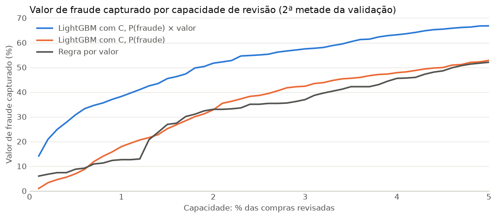
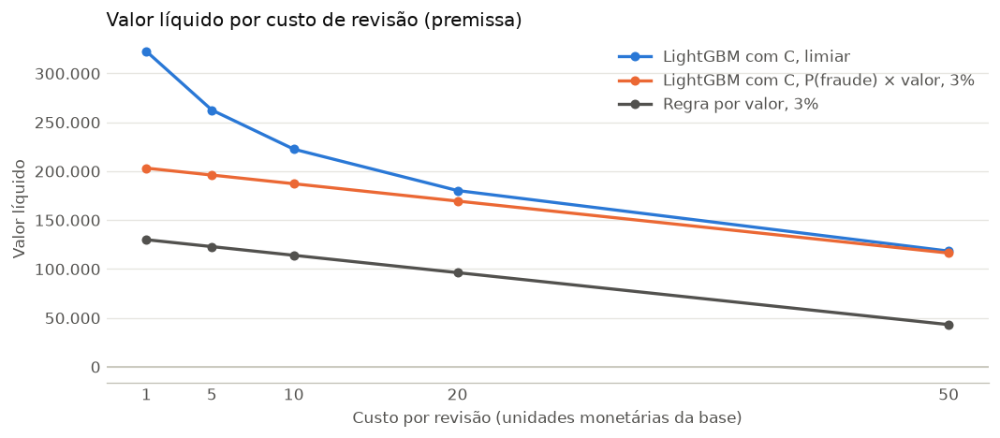

# Priorização de revisão de fraude

## O pedido

*Cenário hipotético, criado para este projeto de portfólio.*

A área de prevenção a fraude de um e-commerce leva um problema para a equipe de dados. Os analistas de revisão só conseguem olhar uma pequena parte das compras, e hoje a regra é simples: revisar as compras de maior valor. A pergunta que chega é direta:

> **Com capacidade limitada de revisão, quais transações revisar para maximizar o valor de fraude capturado?**

O pedido vem com duas condições. A solução precisa funcionar em compras futuras, e não só nas compras já conhecidas. E precisa ser comparada com a regra atual, em dinheiro recuperado, e não só em número de fraudes encontradas.

## Dados

[IEEE-CIS Fraud Detection](https://www.kaggle.com/c/ieee-fraud-detection) (Kaggle), compras de e-commerce de 2017 e 2018. Foram usados só os arquivos de treino, que têm o rótulo de fraude: 590.540 compras e 434 colunas depois de juntar transação e identidade. Os dados não estão no repositório.

A maior parte das colunas é anônima. `TransactionDT` é contada em segundos a partir de uma referência que não é informada, então o projeto usa "dias desde a referência", e nunca datas reais. Os valores não têm símbolo de moeda.

## Etapas

Cada etapa tem um notebook próprio, que termina com uma seção de conclusões. As 22 decisões do projeto, com as alternativas descartadas e os motivos, estão em [docs/decisoes.md](docs/decisoes.md).

### 1. Exploração ([notebook 01](notebooks/01_exploracao.ipynb))
Tudo que envolve o rótulo de fraude usa só os primeiros 60% no tempo, para não espiar o período de teste.
- A taxa de fraude é de 3,38%, mas muda com o tempo: fica entre 1,85% e 2,81% nas semanas 0 a 3 e sobe para entre 3,30% e 4,55% a partir da semana 4.
- Em valor, fraudes e compras legítimas são parecidas (mediana de 77,00 e 69,61). Mas o valor fraudado é concentrado: as 20% maiores fraudes somam 59,59% dele. Daí veio a hipótese de priorizar combinando chance de fraude e valor.
- Os campos vazios também mudam com o tempo, e nenhuma coluna identifica um cartão individual.

### 2. Validação temporal ([notebook 02](notebooks/02_validacao_temporal.ipynb))
As compras foram divididas no tempo: 60% para treino, 20% para validação e 20% para teste. Compras no mesmo instante ficam no mesmo período.
- A validação tem mais fraude do que o treino: 3,90% contra 3,38%, cerca de 15% a mais em proporção.
- Os campos vazios do grupo M caem de 58,79% para 36,89%, e as compras com dados de identidade caem de 27,47% para 19,60%. Padrões aprendidos no treino podem não se manter.

### 3. Baseline ([notebook 03](notebooks/03_baseline.ipynb))
Duas réguas que o modelo principal precisa superar: revisar as compras de maior valor e uma regressão logística.
- A logística ordena fraudes muito melhor (PR-AUC de 0,4357 contra 0,0479), mas a regra por valor captura mais dinheiro em todas as capacidades. Acertar mais fraudes não é o mesmo que recuperar mais valor.
- Quase todo o desempenho da logística vem das colunas C: sem elas, a PR-AUC cai para 0,1351. Como essas colunas não podem ser auditadas, o projeto passou a mostrar sempre as duas versões.

### 4. Variáveis ([notebook 04](notebooks/04_variaveis.ipynb))
Histórico de cada cartão: quantas compras antes, valor médio e tempo desde a última. Cada compra só enxerga o que aconteceu antes dela, e o rótulo de fraude não entra no cálculo, porque só é conhecido semanas depois.
- A melhor aproximação de um cartão combina `card1` a `card6` com o endereço: 39.087 grupos.
- Na logística, o histórico quase não mudou o resultado (PR-AUC entre 0,4303 e 0,4337, contra 0,4357 sem ele).

### 5. Modelo ([notebook 05](notebooks/05_modelo.ipynb))
LightGBM em quatro versões: com e sem colunas C, com e sem histórico do cartão. O número de árvores foi escolhido nos últimos 20% do treino, para a validação ficar intacta.
- O LightGBM superou a logística: PR-AUC de 0,5742 contra 0,4357 com colunas C, e de 0,2806 contra 0,1351 sem elas.
- O histórico do cartão não trouxe melhora clara (0,5742 sem ele e 0,5645 com ele), então ficou fora.

### 6. Calibração ([notebook 06](notebooks/06_calibracao.ipynb))
A validação foi dividida em duas metades no tempo: a primeira ajusta a probabilidade com Platt, e a segunda mede o resultado.
- Sem calibração, o modelo previa 2,82% de fraude, para uma taxa real de 3,49%. Calibrado, prevê 3,57%.
- A ordem das compras não muda, então a PR-AUC fica igual. O que melhora é a probabilidade em si, que a etapa seguinte multiplica pelo valor.

### 7. Negócio ([notebook 07](notebooks/07_negocio.ipynb))
Comparação das filas de revisão e do valor líquido: valor de fraude capturado menos o custo das revisões. O custo é uma premissa, testada de 1 a 50 por revisão.
- Revisando 3% das compras, ordenar por `P(fraude) × valor` captura 57,48% do valor de fraude, contra 42,36% ordenando só por `P(fraude)` e 36,96% pela regra por valor.
- Revisar sempre que o valor esperado de fraude supera o custo (limiar) dá o maior valor líquido, mas pode exigir muito mais revisões do que a equipe consegue fazer. Na operação, a fila para no que vier primeiro: a capacidade da equipe ou o limiar.

### 8. Teste final ([notebook 08](notebooks/08_teste_final.ipynb))
O modelo validado foi aplicado uma única vez no teste, sem nenhum ajuste depois.
- O desempenho caiu (PR-AUC de 0,5461 para 0,4697), e a queda acompanha a distância no tempo. A regra por valor, que não aprende nada, também caiu.
- A conclusão principal se manteve: `P(fraude) × valor` captura 49,74% do valor de fraude em 3%, contra 32,46% da regra por valor.

## Conclusão: o resultado principal

A resposta para a área de prevenção a fraude é ordenar a fila de revisão pelo **valor esperado de fraude**, `P(fraude) × valor`, que multiplica a chance calibrada de fraude pelo valor da compra.

No período de teste, que nenhuma decisão do projeto usou, revisando 3% das compras:

| Como a fila é ordenada | Valor de fraude capturado |
|---|---|
| Compras de maior valor (regra atual) | 32,46% |
| Maior chance de fraude, `P(fraude)` | 32,37% |
| **Maior valor esperado de fraude, `P(fraude) × valor`** | **49,74%** |

Com o mesmo número de revisões, a nova fila captura 17 pontos a mais do valor fraudado do que a regra atual. Ordenar só pela chance de fraude acerta mais fraudes, mas muitas delas têm valor baixo, e no teste empatou com a regra atual.



*Gráfico da 2ª metade da validação. A vantagem da fila por valor esperado aparece em todas as capacidades até 5%.*

Validação e teste lado a lado:

| Métrica | 2ª metade da validação | Teste |
|---|---|---|
| PR-AUC, LightGBM com colunas C | 0,5461 | 0,4697 |
| PR-AUC, LightGBM sem colunas C | 0,2657 | 0,2200 |
| Valor capturado em 3%, regra por valor | 36,96% | 32,46% |
| Valor capturado em 3%, `P(fraude) × valor` com C | 57,48% | 49,74% |
| Valor capturado em 3%, `P(fraude) × valor` sem C | 44,68% | 35,86% |
| Probabilidade média prevista, com C | 3,57% | 3,62% |
| Taxa real de fraude | 3,49% | 3,44% |

Descontando o custo das revisões, que é uma premissa testada de 1 a 50 por revisão, a fila por valor esperado mantém o maior valor líquido em todos os custos testados:



**Recomendações para a área:**
- Ordenar a fila por `P(fraude) × valor` e parar no que vier primeiro: a capacidade da equipe ou o ponto em que o valor esperado de fraude fica abaixo do custo de revisão.
- Treinar o modelo de novo todo mês com os dados mais recentes e acompanhar o valor capturado, porque o desempenho cai à medida que o modelo envelhece.

## Limitações

- **Colunas C.** São contagens pré-calculadas pela empresa que publicou os dados, e não dá para auditar se usam informação futura. Elas respondem pela maior parte do desempenho. Por isso, o modelo é apresentado com e sem elas, e a conclusão principal vale nas duas versões.
- **Premissas de custo.** O custo de revisão não vem dos dados. O projeto supõe que revisar uma fraude evita 100% do valor dela e que revisar uma compra legítima custa só o tempo da revisão.
- **Atraso do rótulo.** Na prática, só se sabe que houve fraude semanas depois, no chargeback. A divisão no tempo não simula essa espera.
- **Envelhecimento.** O modelo perde desempenho com o tempo. A recomendação é treinar de novo todo mês, refazer a calibração e acompanhar o valor capturado. A frequência mensal é uma proposta, não foi testada.
- **Um único período de teste.** Não dá para separar com certeza quanto da queda no teste vem do tempo e quanto vem de escolhas ajustadas à validação.
- **Contexto.** Compras de e-commerce de 2017 e 2018. Os resultados não devem ser generalizados para outros mercados ou períodos.

## Versões

| Pacote | Versão |
|---|---|
| Python | 3.12.16 |
| pandas | 3.1.1 |
| NumPy | 2.5.4 |
| pyarrow | 26.0.1 |
| scikit-learn | 1.9.1 |
| LightGBM | 4.7.0 |
| matplotlib | 3.11.2 |
| JupyterLab | 4.6.6 |
| nbconvert | 7.17.2 |
| pytest | 9.2.0 |
| Kaggle CLI | 2.2.5 |

Ambiente conda (conda-forge) para macOS com Apple Silicon. A lista completa, com todas as dependências, está em [environment-explicit.txt](environment-explicit.txt).

## Como reproduzir

Requer macOS ou Linux com conda e uma conta no Kaggle com as regras da competição aceitas.

```bash
# 1. Ambiente com as versões exatas usadas (osx-arm64)
conda create -p ./.venv --file environment-explicit.txt
# Em Mac sem Homebrew, o pyarrow precisa de um ajuste descrito na decisão D3

# 2. Dados (token do Kaggle em ~/.kaggle/kaggle.json, fora do git)
.venv/bin/kaggle competitions download -c ieee-fraud-detection -f train_transaction.csv -p data/raw
.venv/bin/kaggle competitions download -c ieee-fraud-detection -f train_identity.csv -p data/raw
# descompacte os arquivos em data/raw

# 3. Conversão para parquet com tipos reduzidos
.venv/bin/python src/preparar_dados.py

# 4. Testes
.venv/bin/python -m pytest

# 5. Notebooks, na ordem de 01 a 08
```

Foi tudo feito num MacBook M1 com 8 GB de RAM. Cada notebook carrega só as colunas de que precisa.

## Estrutura

| Caminho | Conteúdo |
|---|---|
| [notebooks/01_exploracao.ipynb](notebooks/01_exploracao.ipynb) | Volume, taxa de fraude, valores, campos vazios e cartões |
| [notebooks/02_validacao_temporal.ipynb](notebooks/02_validacao_temporal.ipynb) | Divisão no tempo e diferenças entre treino e validação |
| [notebooks/03_baseline.ipynb](notebooks/03_baseline.ipynb) | Regra por valor e regressão logística |
| [notebooks/04_variaveis.ipynb](notebooks/04_variaveis.ipynb) | Histórico por cartão e checagem das colunas C |
| [notebooks/05_modelo.ipynb](notebooks/05_modelo.ipynb) | LightGBM em quatro versões |
| [notebooks/06_calibracao.ipynb](notebooks/06_calibracao.ipynb) | Calibração de Platt |
| [notebooks/07_negocio.ipynb](notebooks/07_negocio.ipynb) | Filas, custos e limiar |
| [notebooks/08_teste_final.ipynb](notebooks/08_teste_final.ipynb) | Avaliação única no teste |
| `src/` | Divisão temporal, métricas, histórico por cartão, treino e preparação dos dados |
| `tests/` | Testes das funções em `src/` |
| [docs/decisoes.md](docs/decisoes.md) | Registro das decisões |

## Como este projeto foi feito

Desenvolvido com apoio do Claude Code (Anthropic), como projeto de aprendizado. Eu escrevi a divisão temporal (`src/divisao_temporal.py`) e a métrica de valor capturado (`src/metricas.py`), interpretei cada resultado e tomei as decisões registradas em [docs/decisoes.md](docs/decisoes.md). O Claude escreveu o restante do código, corrigiu possíveis erros de lógica durante o processo e ajustou o fluxograma da sequência dos notebooks.


